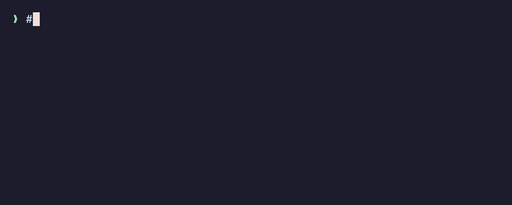

# Attributed

**See which lines in every commit an AI agent wrote, recorded from the agent's own edit hooks and stored in Git notes beside your history.**

[](https://github.com/amichne/attributed/actions/workflows/ci.yml)
[](LICENSE)
[](go.mod)
[](https://attributed.mintlify.app)



Agent hooks snapshot each file before and after the agent touches it. When you commit, a Git hook replays those snapshots against what Git actually staged and writes the line ranges to `refs/notes/attributed`. That ref is ordinary Git data, so it travels with pushes and stays readable after you uninstall Attributed.

## Features

| Feature | Description |
| --- | --- |
| Agent capture | Hooks for Claude Code, Factory, Codex, GitHub Copilot, VS Code, Cursor, Windsurf, Gemini CLI, Grok, and OpenCode, plus a generic `agent-v1` input |
| Commit reconciliation | Ranges follow what was committed, through partial staging, amend, rebase, stash, and linked worktrees |
| Git-native storage | One JSON note per commit under `refs/notes/attributed`, readable with `git notes` alone |
| Note sharing | The pre-push hook pushes notes with your branches and merges notes other clones pushed. `--local-notes` keeps them local |
| Verification | `git attributed verify` checks every note against its commit's blobs and line counts |
| Interop | Export to Git AI v3 and Agent Trace 0.1. Import Git AI notes and existing git-byline notes |
| No services | One Go binary built only from the standard library. No daemon, account, or background network |

## Install

There is no release yet. Install from source with Go 1.24 or later:

```bash
go install github.com/amichne/attributed/cmd/git-attributed@latest
```

The binary lands in `$(go env GOBIN)`, or `$(go env GOPATH)/bin` when `GOBIN` is unset. Put that directory on `PATH`, and Git runs the binary as `git attributed`.

## Quick start

In a repository you work on with Claude Code:

```bash
git attributed install-hooks --agent claude --git
```

This merges capture hooks into `.claude/settings.json` and installs the Git hooks: post-commit annotation, rewrite tracking, and pre-push note sharing. Add `--local-notes` if notes should stay out of your pushes. Then work as usual. After the next commit:

```bash
git attributed blame path/to/file
git attributed verify
```

### Other agents

| Agent | Setup |
| --- | --- |
| Factory | `git attributed install-hooks --agent droid --git` |
| Claude Code, as a plugin | `claude plugin marketplace add 'https://github.com/amichne/attributed.git#harness/claude'`, then `claude plugin install git-attributed@attributed` |
| Gemini CLI | `gemini extensions install https://github.com/amichne/attributed --ref harness/gemini` |
| Codex, Copilot, VS Code, Cursor, Windsurf, Grok, OpenCode | Copy the hook file for your agent from [`marketplace/harness`](marketplace/harness/README.md), then run `git attributed install-hooks --agent none --git` |

## Usage

| Command | What it does |
| --- | --- |
| `git attributed blame [--json] <file>` | Attribution for every line at HEAD: `human`, `ai`, `human-override`, or `untracked` |
| `git attributed status [--json]` | Pending checkpoints, retained snapshots, and annotation state |
| `git attributed verify [<range>] [--deep]` | Check notes against blobs and range coverage. `--deep` also reads blob content |
| `git attributed export --format gitai\|agent-trace` | Write one commit's attribution in an interop format |
| `git attributed import --format gitai\|byline --range HEAD` | Copy Git AI or git-byline notes into `refs/notes/attributed` without replacing different notes |
| `git attributed recover` | Preview or resolve checkpoints stranded by branch switches |
| `git attributed uninstall --agent claude --git` | Remove only the hooks Attributed manages |

`git attributed help <command>` prints the full flags for each one.

### Read notes without Attributed

```bash
git notes --ref=attributed show HEAD
```

Abridged output:

```json
{"version":4,"files":{"math.py":{"blob":"d32f681…","ranges":[{"start":1,"end":2,"author":"human","identity":"ada"},{"start":3,"end":5,"author":"ai","agent":"claude","model":"claude-opus-5-5","session":"demo","ts":"2026-11-27T18:32:25.704454Z"}]}}}
```

Notes contain repository paths, line ranges, agent and model names, human identity tokens, session identifiers, timestamps, and blob IDs. They contain no prompts or transcripts.

### Migrate from git-byline

```bash
git fetch origin refs/notes/byline:refs/notes/byline
git-byline uninstall --git
git attributed import --format byline --range HEAD
git attributed install-hooks --git
```

Skip the fetch if your notes only exist locally. Each upstream note is checked against its commit and copied byte for byte.

## Limits

- **Unobserved lines count as human.** A line that changed with no matching agent checkpoint is attributed to the commit author. Telling missing evidence apart from observed human edits is an open proposal.
- **Shell edits can be ambiguous.** When two sessions run shell commands over the same file and the harness supplies no event ID, a checkpoint can't always be assigned to one session.
- **Attribution is self-reported.** Notes record what local hooks observed. Signed notes are tracked in [#8](https://github.com/amichne/attributed/issues/8).

## Documentation

[attributed.mintlify.app](https://attributed.mintlify.app) covers the upstream baseline, the qualification plan, and the extraction from git-byline. That includes the naming map, the projected agent integrations, and marketplace publication.

## Development

```bash
CGO_ENABLED=0 go build -trimpath -o git-attributed ./cmd/git-attributed
go test ./...
ATTRIBUTED_BIN=./git-attributed bash scripts/smoke.sh
```

CI runs these on Linux and macOS for every pull request. It also runs the Python tool checks, the projection drift check, and documentation validation. A few things to know before changing files:

- `marketplace/` and `commands/` are generated from `integrations/`. Change the source and regenerate as the [projection guide](docs/extraction.mdx#project-harness-integrations) describes.
- `python3 tools/toolchain/toolchain.py run -- <command>` runs a command with the checksum-pinned uv and Pkl.
- Preview docs with `mint dev --no-open` in `docs/`. Run `mint validate` and `mint broken-links` before committing changes there.
- Re-record the demo with [VHS](https://github.com/charmbracelet/vhs): `vhs docs/assets/blame.tape` builds the binary from the checkout and writes `docs/assets/blame.gif`.

## License

[MIT](LICENSE). Attributed derives from [git-byline](https://github.com/comarch/git-byline) by Comarch S.A., also MIT, so copies keep the [upstream notice](LICENSE.upstream). Every binary embeds both notices; `git attributed license` prints them.

Maintained by [](https://github.com/amichne).
